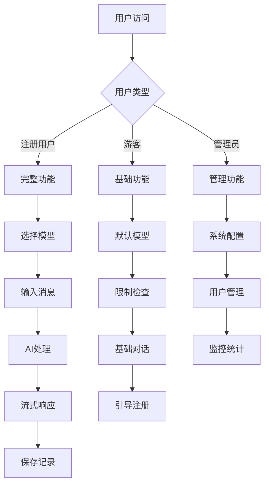

# AI模块产品需求文档

## 1. 产品概述

基于LangChain4j 1.2.0框架的智能对话AI模块，为用户提供多模型、多场景的AI聊天服务。该模块支持流式响应、对话记忆、模型切换等核心功能，旨在打造高性能、易扩展的企业级AI对话平台。

产品解决用户与AI模型交互的复杂性问题，通过统一的API接口和友好的用户体验，让开发者和最终用户都能轻松使用各种AI能力。目标是成为企业内部AI服务的核心基础设施。

## 2. 核心功能

### 2.1 用户角色

| 角色 | 注册方式 | 核心权限 |
|------|----------|----------|
| 游客用户 | 无需注册，临时访问 | 基础聊天功能，有使用次数限制 |
| 注册用户 | 邮箱注册验证 | 完整聊天功能，对话历史保存，模型选择 |
| 管理员 | 系统分配 | 用户管理，模型配置，系统监控 |

### 2.2 功能模块

我们的AI模块需求包含以下主要页面：
1. **聊天对话页面**：实时AI对话界面，支持流式响应和历史记录
2. **模型选择页面**：AI模型管理和切换界面
3. **对话历史页面**：用户对话记录管理和搜索
4. **系统设置页面**：AI参数配置和用户偏好设置

### 2.3 页面详情

| 页面名称 | 模块名称 | 功能描述 |
|----------|----------|----------|
| 聊天对话页面 | 消息输入区 | 支持文本输入、快捷指令、文件上传等多种输入方式 |
| 聊天对话页面 | 对话显示区 | 实时显示用户和AI消息，支持Markdown渲染、代码高亮 |
| 聊天对话页面 | 流式响应 | AI消息逐字显示，提供打字机效果和实时反馈 |
| 聊天对话页面 | 操作工具栏 | 消息复制、重新生成、点赞评分、分享导出功能 |
| 模型选择页面 | 模型列表 | 显示可用AI模型，包含性能指标和适用场景说明 |
| 模型选择页面 | 参数配置 | 调整温度、最大token、超时时间等模型参数 |
| 模型选择页面 | 模型测试 | 提供模型性能测试和对比功能 |
| 对话历史页面 | 历史列表 | 按时间排序显示用户所有对话记录 |
| 对话历史页面 | 搜索过滤 | 支持关键词搜索、时间筛选、模型筛选 |
| 对话历史页面 | 对话管理 | 重命名、删除、导出、分享对话记录 |
| 系统设置页面 | 用户偏好 | 主题设置、语言选择、通知配置 |
| 系统设置页面 | AI配置 | 默认模型选择、响应速度偏好、安全设置 |
| 系统设置页面 | 数据管理 | 清除缓存、导出数据、隐私设置 |

## 3. 核心流程

### 注册用户流程
1. 用户访问聊天页面
2. 选择AI模型和配置参数
3. 输入消息内容
4. 系统验证用户权限和输入内容
5. 调用AI模型生成响应
6. 流式返回AI响应内容
7. 保存对话记录到数据库
8. 更新用户使用统计

### 游客用户流程
1. 游客访问聊天页面（无需登录）
2. 系统分配临时会话ID
3. 使用默认AI模型进行对话
4. 检查使用次数限制
5. 提供基础聊天功能
6. 引导用户注册获取完整功能

### 管理员流程
1. 管理员登录系统
2. 访问模型管理界面
3. 配置AI模型参数
4. 监控系统使用情况
5. 管理用户权限和限制

## 4. 用户界面设计

### 4.1 设计风格

- **主色调**：深蓝色(#1890ff)作为主色，浅灰色(#f5f5f5)作为背景色
- **按钮样式**：圆角矩形按钮，支持悬停和点击动效
- **字体**：中文使用"PingFang SC"，英文使用"Roboto"，代码使用"Fira Code"
- **布局风格**：左侧导航+右侧内容的经典布局，支持响应式设计
- **图标风格**：使用Ant Design图标库，保持视觉一致性

### 4.2 页面设计概览

| 页面名称 | 模块名称 | UI元素 |
|----------|----------|--------|
| 聊天对话页面 | 消息输入区 | 多行文本框，发送按钮，附件上传，快捷指令下拉菜单 |
| 聊天对话页面 | 对话显示区 | 消息气泡卡片，用户头像，时间戳，Markdown渲染区域 |
| 聊天对话页面 | 侧边栏 | 对话列表，新建对话按钮，搜索框，设置入口 |
| 模型选择页面 | 模型卡片 | 模型名称，性能指标，适用场景标签，选择按钮 |
| 模型选择页面 | 参数面板 | 滑块控件，数值输入框，预设配置下拉菜单 |
| 对话历史页面 | 列表视图 | 对话标题，预览内容，时间标签，操作按钮组 |
| 对话历史页面 | 搜索栏 | 关键词输入框，高级筛选按钮，排序选择器 |
| 系统设置页面 | 配置表单 | 开关组件，选择器，颜色选择器，重置按钮 |

### 4.3 响应式设计

产品采用移动优先的响应式设计策略，支持桌面端、平板和手机端的完美适配。在移动端优化触摸交互体验，包括手势操作、长按菜单等功