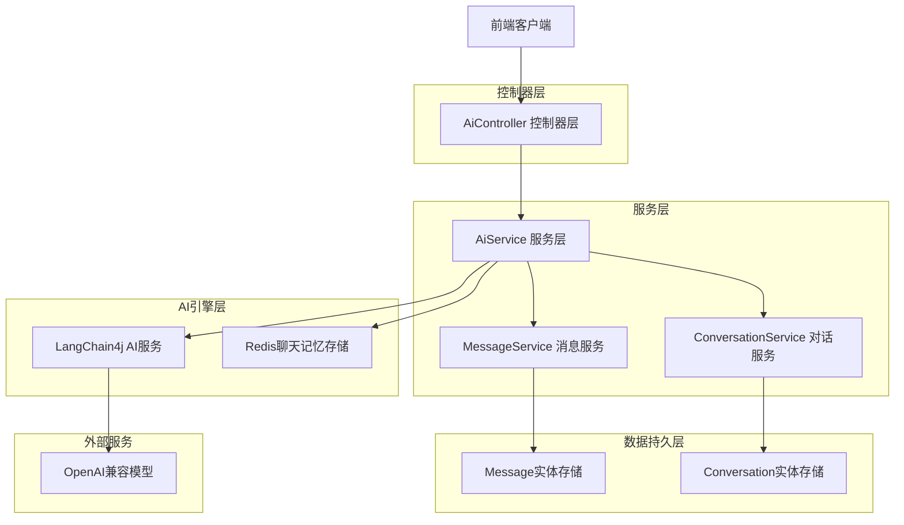
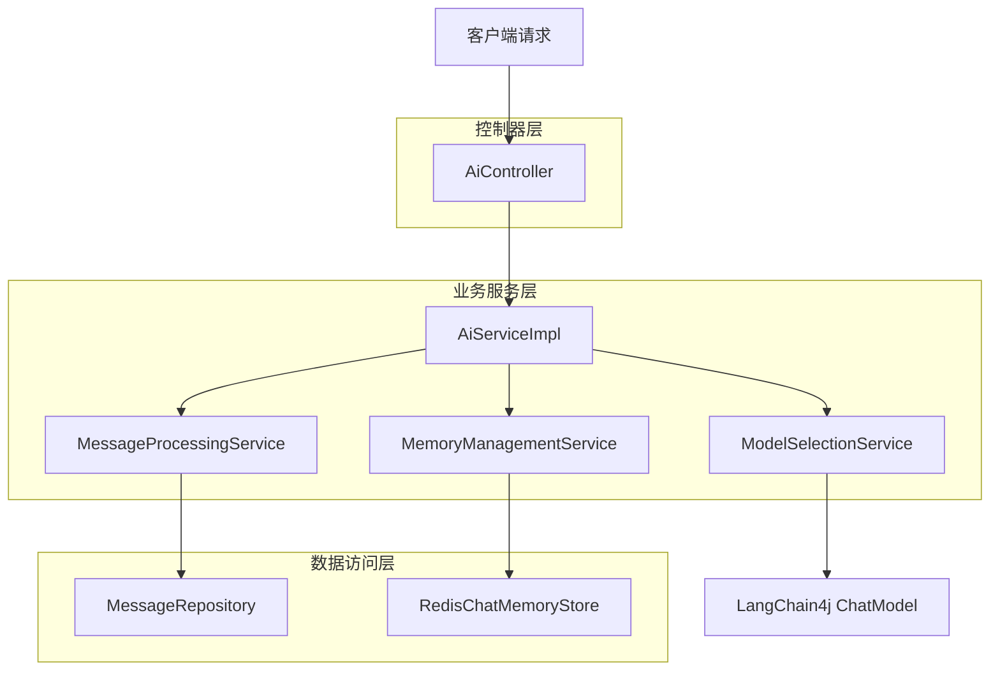
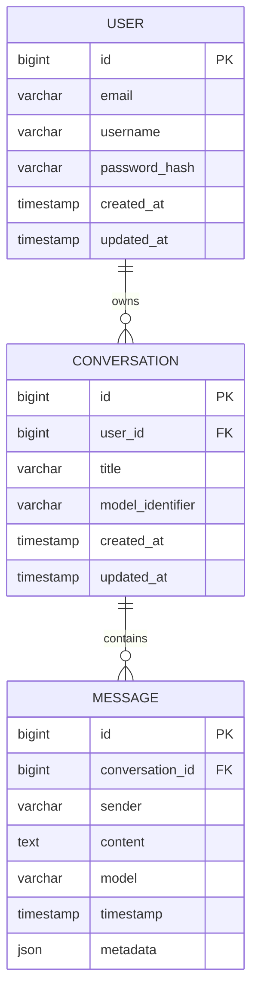

# AI模块完善技术架构文档

## 1. 架构设计



## 2. 技术描述

- 前端: Vue3 + Vite
- 后端: Spring Boot 3.x + Spring WebFlux
- AI框架: LangChain4j 1.2.0
- 数据库: R2DBC + PostgreSQL
- 缓存: Redis (聊天记忆存储)
- 消息队列: RabbitMQ (可选，用于异步处理)

## 3. 路由定义

| 路由 | 用途 |
|------|------|
| /api/ai/chat/stream | 流式聊天接口，支持实时响应 |
| /api/ai/chat/sync | 同步聊天接口，等待完整响应 |
| /api/ai/models | 获取可用AI模型列表 |
| /api/ai/conversations | 获取用户对话历史 |
| /api/ai/conversations/{id}/messages | 获取特定对话的消息历史 |
| /api/ai/memory/clear/{conversationId} | 清除特定对话的记忆 |

## 4. API定义

### 4.1 核心API

#### 流式聊天接口
```
POST /api/ai/chat/stream
```

请求参数:
| 参数名 | 参数类型 | 是否必需 | 描述 |
|--------|----------|----------|------|
| prompt | string | true | 用户输入的消息内容 |
| conversationId | string | false | 对话ID，用于记忆管理 |
| model | string | false | 指定使用的AI模型 |
| temperature | double | false | 模型温度参数 |
| maxTokens | integer | false | 最大token数量 |

响应: Server-Sent Events (SSE) 流
```json
{
  "type": "message",
  "content": "AI响应内容片段",
  "conversationId": "conv_123",
  "timestamp": 1703123456789
}
```

#### 同步聊天接口
```
POST /api/ai/chat/sync
```

请求参数: 同流式接口

响应:
```json
{
  "success": true,
  "message": "完整的AI响应内容",
  "conversationId": "conv_123",
  "modelIdentifier": "glm-4.5-air",
  "timestamp": 1703123456789,
  "duration": 2500,
  "tokenCount": 150
}
```

## 5. 服务架构图



## 6. 数据模型

### 6.1 数据模型定义



### 6.2 数据定义语言

#### 消息表增强 (messages)
```sql
-- 为现有message表添加新字段
ALTER TABLE message ADD COLUMN IF NOT EXISTS metadata JSONB;
ALTER TABLE message ADD COLUMN IF NOT EXISTS token_count INTEGER;
ALTER TABLE message ADD COLUMN IF NOT EXISTS response_time_ms INTEGER;

-- 创建索引优化查询性能
CREATE INDEX IF NOT EXISTS idx_message_conversation_timestamp 
ON message(conversation_id, timestamp DESC);

CREATE INDEX IF NOT EXISTS idx_message_sender 
ON message(sender);
```

#### AI模型配置表 (ai_models)
```sql
-- 创建AI模型配置表
CREATE TABLE IF NOT EXISTS ai_models (
    id BIGSERIAL PRIMARY KEY,
    model_identifier VARCHAR(100) UNIQUE NOT NULL,
    model_name VARCHAR(200) NOT NULL,
    provider VARCHAR(50) NOT NULL,
    max_tokens INTEGER DEFAULT 4000,
    temperature DECIMAL(3,2) DEFAULT 0.7,
    timeout_ms INTEGER DEFAULT 30000,
    is_active BOOLEAN DEFAULT true,
    created_at TIMESTAMP WITH TIME ZONE DEFAULT NOW(),
    updated_at TIMESTAMP WITH TIME ZONE DEFAULT NOW()
);

-- 插入初始模型配置
INSERT INTO ai_models (model_identifier, model_name, provider, max_tokens, temperature, timeout_ms) VALUES
('glm-4.5-air', 'GLM-4.5-Air', 'siliconflow', 4000, 0.3, 15000),
('deepseek-v3', 'DeepSeek-V3', 'siliconflow', 6000, 0.5, 20000),
('qwen-long', 'QwenLong-L1-32B', 'siliconflow', 16000, 0.7, 25000);
```

## 7. 三步法实施计划

### 第一步：完善AI服务层架构

#### 目标
- 重构Aiservice接口，支持多种AI操作
- 创建具体实现类，遵循单一职责原则
- 优化LangChain4j配置，支持动态模型切换
- 集成现有DTO类型

#### 具体实现
1. **重构Aiservice接口**
   - 添加同步和异步聊天方法
   - 支持模型选择和参数配置
   - 添加对话管理方法

2. **创建AiServiceImpl实现类**
   - 实现具体的AI交互逻辑
   - 集成消息持久化
   - 添加错误处理和重试机制

3. **优化LangChain4j配置**
   - 支持多模型Bean配置
   - 动态模型切换机制
   - 配置参数外部化

#### 注意事项
- 遵循单一职责原则，避免服务类过于庞大
- 使用依赖注入，便于测试和维护
- 添加详细的中文注释，便于排错

### 第二步：增强消息处理和记忆管理

#### 目标
- 完善Redis聊天记忆存储
- 优化消息转换逻辑
- 集成Message实体持久化
- 支持流式和同步响应

#### 具体实现
1. **增强记忆管理**
   - 优化RedisChatMemoryStore实现
   - 添加记忆清理和管理功能
   - 支持不同记忆策略

2. **消息处理优化**
   - 创建MessageProcessingService
   - 实现消息格式转换
   - 添加消息验证和过滤

3. **响应模式支持**
   - 实现SSE流式响应
   - 保持同步响应兼容性
   - 添加响应状态管理

#### 注意事项
- 确保消息持久化的事务一致性
- 优化Redis连接池配置
- 处理流式响应的异常情况

### 第三步：完善控制器层和错误处理

#### 目标
- 重构AiController，添加完整API
- 实现统一错误处理
- 添加模型管理功能
- 集成用户认证

#### 具体实现
1. **控制器重构**
   - 添加多个API端点
   - 实现参数验证
   - 支持不同响应格式

2. **错误处理机制**
   - 创建全局异常处理器
   - 定义错误码和错误消息
   - 添加日志记录

3. **模型管理**
   - 实现模型配置CRUD
   - 动态模型切换
   - 模型性能监控

#### 注意事项
- 确保API的向后兼容性
- 添加适当的安全验证
- 优化错误信息的用户友好性

## 8. 关键技术要点

### 8.1 LangChain4j 1.2.0 最佳实践
- 使用@AiService注解进行服务定义
- 配置ChatMemoryProvider进行记忆管理
- 利用StreamingChatModel实现流式响应
- 合理配置模型参数和超时时间

### 8.2 性能优化建议
- 使用连接池管理AI模型连接
- 实现请求缓存减少重复调用
- 优化数据库查询和索引
- 监控和限制并发请求数量

### 8.3 安全考虑
- API密钥安全存储和轮换
- 用户输入验证和过滤
- 请求频率限制
- 敏感信息脱敏处理

## 9. 部署和监控

### 9.1 部署要求
- Java 17+
- Spring Boot 3.x
- Redis 6.0+
- PostgreSQL 13+

### 9.2 监控指标
- AI响应时间和成功率
- 内存使用情况
- 数据库连接池状态
- Redis缓存命中率

### 9.3 日志配置
- 结构化日志输出
- 错误堆栈跟踪
- 性能指标记录
- 用户操作审计