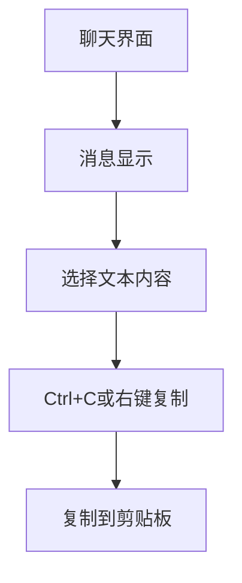

# 消息文本选择复制功能产品需求文档

## 1. 产品概述

为AI聊天系统实现消息文本选择和复制功能，允许用户选取AI输出或用户消息的文本内容进行复制。
- 解决用户无法选择和复制聊天消息内容的问题，提高内容使用效率
- 面向所有使用AI聊天系统的用户，包括注册用户和游客用户
- 通过简单的文本选择操作，提升用户体验和内容分享便利性

## 2. 核心功能

### 2.1 用户角色

| 角色 | 注册方式 | 核心权限 |
|------|----------|----------|
| 注册用户 | 邮箱注册 | 可使用所有聊天功能，包括消息复制 |
| 游客用户 | 自动获取游客身份 | 可使用基础聊天功能，包括消息复制 |

### 2.2 功能模块

我们的消息文本选择复制功能包含以下主要页面：
1. **聊天界面**：消息显示区域，支持文本选择操作
2. **消息组件**：单条消息的文本选择和复制功能实现

### 2.3 页面详情

| 页面名称 | 模块名称 | 功能描述 |
|----------|----------|----------|
| 聊天界面 | 消息列表 | 显示用户和AI消息，支持文本选择操作 |
| 聊天界面 | 文本选择 | 允许用户选择消息中的任意文本内容 |
| 消息组件 | 文本处理 | 确保消息文本可被正常选择，保持文本格式 |
| 消息组件 | 复制操作 | 支持标准的Ctrl+C复制操作和右键菜单复制 |

## 3. 核心流程

**用户操作流程：**
1. 用户在聊天界面查看AI回复消息或用户消息
2. 使用鼠标选择需要复制的文本内容
3. 使用Ctrl+C快捷键或右键菜单进行复制
4. 文本内容被复制到用户剪贴板
5. 用户可在其他应用中粘贴使用

## 4. 用户界面设计

### 4.1 设计风格

- 主色调：保持与现有聊天界面一致的深色主题
- 文本选择：支持标准的文本选择高亮显示
- 字体：使用系统默认字体，确保跨平台兼容性和可读性
- 布局风格：消息内容区域支持文本选择，不影响消息阅读体验
- 交互风格：遵循系统标准的文本选择和复制交互模式

### 4.2 页面设计概览

| 页面名称 | 模块名称 | UI元素 |
|----------|----------|--------|
| 聊天界面 | 消息区域 | 消息内容支持文本选择，选中文本显示高亮背景色 |
| 聊天界面 | 文本选择 | 标准的文本选择光标和选择范围显示 |
| 移动端适配 | 触摸选择 | 支持长按选择文本，显示选择手柄，支持拖拽调整选择范围 |

### 4.3 响应式设计

产品采用移动端优先设计，支持桌面端和移动端自适应，文本选择功能在移动端进行触摸交互优化，支持长按选择和拖拽调整。