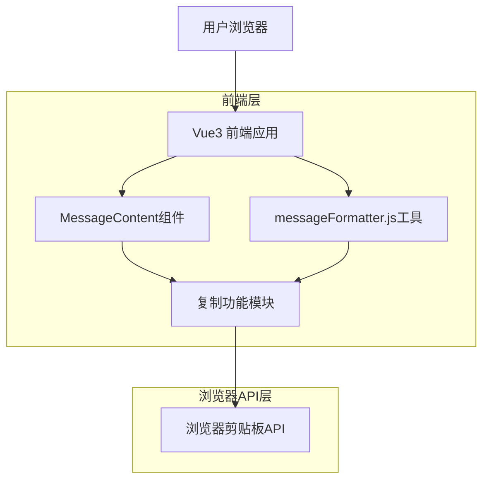

# 消息复制功能技术架构文档

## 1. 架构设计



## 2. 技术描述

- 前端：Vue3 + Composition API + CSS3
- 工具库：现有的messageFormatter.js扩展
- 浏览器API：Clipboard API + 降级方案

## 3. 路由定义

| 路由 | 用途 |
|------|------|
| / | 主聊天界面，包含消息复制功能 |
| /login | 登录页面 |
| /register | 注册页面 |

## 4. API定义

### 4.1 核心功能模块

**消息复制相关功能**

前端工具函数：
```javascript
// 复制消息内容到剪贴板
export function copyMessageContent(messageId, content)
```

参数说明：
| 参数名称 | 参数类型 | 是否必需 | 描述 |
|----------|----------|----------|------|
| messageId | string | true | 消息的唯一标识符 |
| content | string | true | 要复制的消息内容（HTML格式） |

返回值：
| 参数名称 | 参数类型 | 描述 |
|----------|----------|------|
| success | boolean | 复制操作是否成功 |
| message | string | 操作结果消息 |

示例：
```javascript
// 调用示例
copyMessageContent('msg-123', '<p>这是AI的回复内容</p>')

// 返回示例
{
  "success": true,
  "message": "内容已复制到剪贴板"
}
```

## 5. 前端架构图

```mermaid
graph TD
  A[MarketingPlatform.vue] --> B[MessageContent.vue]
  B --> C[复制按钮组件]
  C --> D[messageFormatter.js]
  D --> E[copyMessageContent函数]
  E --> F[extractPlainText函数]
  E --> G[copyToClipboard函数]
  G --> H[showC