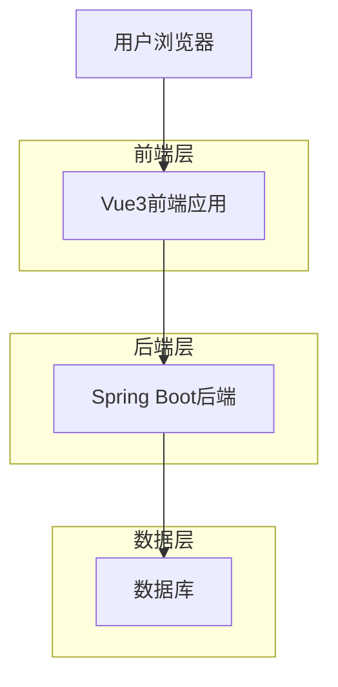

# 消息文本选择复制技术架构文档

## 1. 架构设计



## 2. 技术描述

- 前端：Vue3 + JavaScript + CSS3
- 后端：Spring Boot + Java
- 数据库：现有数据库（无需修改）

## 3. 路由定义

| 路由 | 用途 |
|------|------|
| / | 主聊天界面，支持消息文本选择和复制功能 |
| /login | 登录页面 |
| /register | 注册页面 |

## 4. 前端实现方案

### 4.1 核心功能实现

**文本选择功能：**
- 移除现有消息组件中可能存在的 `user-select: none` CSS属性
- 确保消息内容区域支持标准的文本选择操作
- 保持消息格式的同时允许文本选择

**CSS样式调整：**
```css
/* 确保消息内容可选择 */
.message-content {
  user-select: text;
  -webkit-user-select: text;
  -moz-user-select: text;
  -ms-user-select: text;
}

/* 文本选择高亮样式 */
.message-content::selection {
  background-color: #007acc;
  color: white;
}

.message-content::-moz-selection {
  background-color: #007acc;
  color: white;
}
```

**移动端适配：**
- 支持长按选择文本
- 显示系统默认的选择手柄
- 支持拖拽调整选择范围

### 4.2 组件修改

**MessageContent.vue组件：**
- 确保消息内容的可选择性
- 保持现有的代码高亮和格式化功能
- 不影响现有的代码块复制功能

**MarketingPlatform.vue组件：**
- 无需修改主要逻辑
- 确保消息列表区域支持文本选择

## 5. 实现步骤

### 5.1 前端修改

1. **检查并修改CSS样式**
   - 检查MessageContent.vue组件的样式
   - 移除可能阻止文本选择的CSS属性
   - 添加文本选择高亮样式

2. **测试文本选择功能**
   - 验证用户消息和AI消息都可以被选择
   - 测试移动端长按选择功能
   - 确保不影响现有功能

3. **兼容性测试**
   - 测试不同浏览器的文本选择行为
   - 验证移动端Safari和Chrome的选择功能
   - 确保与现有代码复制功能不冲突

### 5.2 无需后端修改

文本选择和复制功能完全在前端实现，无需修改后端API或数据库结构。

## 6. 技术要点

### 6.1 CSS用户选择属性

```css
/* 允许文本选择 */
user-select: text;

/* 禁止文本选择 */
user-select: none;

/* 自动选择（默认行为） */
user-select: auto;
```

### 6.2 移动端文本选择

- iOS Safari：支持长按选择，显示选择手柄
- Android Chrome：支持长按选择，显示选择菜单
- 确保触摸事件不被其他交互阻止

### 6.3 兼容性考虑

- 现代浏览器都支持标准的文本选择API
- 移动端浏览器支持触摸选择
- 无需额外的JavaScript库或框架

## 7. 测试方案

### 7.1 功能测试

- 桌面端鼠标拖拽选择文本
- 移动端长按选择文本
- Ctrl+C快捷键复制
- 右键菜单复制
- 跨应用粘贴测试

### 7.2 兼容性测试

- Chrome、Firefox、Safari、Edge浏览器测试
- iOS Safari、Android Chrome移动端测试
- 不同屏幕尺寸的响应式测试