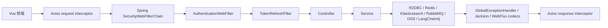

# 项目中间件与代码阅读地图

这份文档把当前项目里的“中间件”分成两层来看：

- 请求链中间件：一次 HTTP 请求从前端到后端时经过的拦截、认证、错误处理、性能统计、序列化等组件。
- 基础设施中间件：Redis、RabbitMQ、Elasticsearch、Nacos、MySQL/R2DBC、LangChain4j、OSS 等支撑业务运行的外部系统和集成层。

阅读时不要把它当成依赖清单，而要把它当成“代码路线图”：每个中间件都回答三个问题：它拦在哪里、它保护或加速了什么、如果它坏了会出现什么症状。

## 一、项目整体链路

### 1. 普通 API 请求链路

这条链路最适合从登录、搜索、聊天三个入口读起：

- 登录：`frontend/src/services/apiClient.js` -> `UserController` -> `UserServiceImpl` -> `JwtUtil` -> Redis JTI 白名单。
- 受保护接口：`SecurityConfig` 先认证，再把用户身份放入 `Authentication`，Controller 从 `Authentication` 或 `ReactiveSecurityContextHolder` 取当前用户。
- 响应返回：后端可能通过 `X-Refreshed-Token` 返回新 Token，前端拦截器写回本地会话。

### 2. 文档处理异步链路

这条链路的核心不是 Controller，而是“事务内记录意图、事务外异步投递”的阶段推进。`DocumentProcessingOutboxService` 先持久化消息，`DocumentProcessingOutboxDispatchTask` 再等待 RabbitMQ broker confirm；失败会退避重试，进程在 confirm 后宕机时可能重复投递，但下游处理记录会吸收重复消息。retry queue 与 DLQ 仍处理消费阶段失败。

## 二、请求链中间件

| 中间件/组件 | 关键文件 | 它做什么 | 失效时的症状 |
| --- | --- | --- | --- |
| 用户端 Axios 拦截器 | `frontend/src/services/apiClient.js` | 请求前统一加 `Authorization: Bearer ...`；响应后读取 `x-refreshed-token`；遇到 401 清理会话并跳登录 | 明明已登录但接口 401；Token 刷新后前端仍用旧 Token |
| 用户端 Router Guard | `frontend/src/router/index.js` | 保护首页；未登录访问首页时自动创建游客账号；登录页处理游客会话清理 | 未登录无法体验；游客和正式用户状态混乱 |
| 游客会话检查 | `frontend/src/services/guestSessionService.js` | 前端侧按 3 小时判断游客会话是否过期，过期后清理本地状态 | 游客过期后仍停留在页面，后续接口陆续 401 |
| 心跳服务 | `frontend/src/services/heartbeatService.js` | 页面可见且有 Token 时定期请求 `/users/me`，辅助维持活跃状态并发现失效登录 | 长时间停留后状态不刷新，用户以为仍在线 |
| 管理端 Axios 拦截器 | `frontend_admin/src/service/http/index.js` | 管理后台统一加 Token，统一 unwrap 响应，处理 401/403 跳转 | 管理后台权限错误无法统一处理 |
| 管理端 Router Guard | `frontend_admin/src/router/guards.js` | 管理后台路由鉴权，进入受保护页面前拉取当前管理员信息 | 刷新后台页面后状态丢失或误跳转 |
| Spring Security 链 | `SecurityConfig` | 关闭 CSRF/basic/formLogin，配置 CORS、公开路径、管理员路径和自定义认证过滤器 | 公开接口被拦、管理员接口误放行、跨域失败 |
| `AuthenticationWebFilter` | `SecurityConfig.securityWebFilterChain` | Spring Security 真正执行认证的 WebFlux filter；使用项目自定义 converter/manager | 请求带 Token 但无法生成 `Authentication` |
| 认证转换器 | `SecurityConfig.combinedAuthenticationConverter` | 从 `Authorization` Header 解析 JWT；对 `/api/ai/chat?ticket=...` 支持一次性 ticket | SSE 或普通 API 找不到凭据 |
| 认证管理器 | `SecurityConfig.combinedAuthenticationManager` | 校验 JWT 的 username/jti/type，再检查 Redis 中的 `token:jti:*` 是否存在；也消费 ticket | 登出后的 Token 仍可用，或有效 Token 被拒绝 |
| Token 刷新 Filter | `TokenRefreshFilter` | 在响应提交前检查 Token 是否进入刷新窗口；生成新 Token 写入 `X-Refreshed-Token`；更新游客活跃时间 | 用户频繁掉线；游客清理依据不准确 |
| CORS 配置 | `SecurityConfig.corsConfigurationSource` | 限制允许的前端 Origin、方法、Header，并暴露 `X-Refreshed-Token` | 浏览器跨域失败，或前端读不到刷新 Token Header |
| API 性能 Filter | `PerformanceConfig.apiPerformanceFilter` | 统计 `/api/**` 请求耗时到 Micrometer，慢请求写日志 | 线上慢接口难以定位 |
| 全局异常处理 | `GlobalExceptionHandler` | 把校验错误、参数错误、权限错误、运行时异常统一成 `{code,errorCode,message,timestamp,path}` | 前端拿到不一致错误结构，内部异常泄露给用户 |
| WebFlux 编解码配置 | `WebFluxConfig` | 设置请求体/上传相关内存上限，支撑较大文档上传 | 上传文档时 400/413 或内存限制异常 |
| Jackson 配置 | `JacksonConfig` | 支持 Java 时间类型；忽略未知字段；避免 LocalDateTime 序列化问题 | 前端多传字段导致 400，时间字段格式异常 |
| PasswordEncoder | `AppConfig` | 提供 BCrypt 密码加密和校验 | 密码明文风险，或登录时密码匹配失败 |

## 三、基础设施中间件

| 中间件 | 关键文件 | 在项目中的职责 | 主要调用点 |
| --- | --- | --- | --- |
| Nacos | `bootstrap.properties`、`AiModelProperties`、`AiModelConfig`、`RabbitMQConfig`、`OssProperties` | 配置中心和服务发现；把数据库、Redis、RabbitMQ、AI 模型、JWT 等配置从外部注入项目 | `@ConfigurationProperties`、`@RefreshScope` |
| MySQL + R2DBC + Flyway | `R2dbcConfig`、`FlywayConfig`、`V5__add_document_processing_outbox.sql` | 响应式访问 MySQL；Flyway 在启动期通过 JDBC 执行不可变迁移；outbox 把业务状态和待投递事件放进同一事务 | 各类 `Repository`、`DatabaseClient`、`TransactionalOperator`、定时清理任务 |
| Redis | `RedisConfig`、`CacheConfig`、`RedisChatMemeoryStore`、`TicketService` | Token JTI 白名单、一次性 ticket、游客活跃状态、聊天记忆、Spring Cache | `UserServiceImpl`、`AdminAuthServiceImpl`、`TokenRefreshFilter`、`ChatMemoryProvider` |
| Spring Cache on Redis | `CacheConfig`、`ConversationServiceImpl` | 给对话列表、搜索结果、消息等配置不同 TTL，减少重复查询 | `@Cacheable`、`@CacheEvict` |
| RabbitMQ + Outbox | `DocumentProcessingRabbitConfig`、`DocumentProcessingOutboxService`、`DocumentProcessingOutboxDispatchTask`、`DocumentProcessingHandler` | 文档解析、分块、向量化的至少一次异步流水线；发布端使用 mandatory + confirm，消费端使用 manual ack、retry queue、DLQ | `sendProcessingMessage`（写 outbox）、`dispatchPending`、`@RabbitListener` |
| RabbitMQ AI task 队列 | `RabbitMQConfig` | 定义 `ai-task-queue`、DLQ、交换机和 JSON 转换器 | 当前主业务代码里没有发现对应生产者/消费者，像是保留或早期设计 |
| Elasticsearch 对话索引 | `ElasticsearchConfig`、`SearchServiceImpl`、`ConversationDocumentRepository` | 把对话内容索引到 ES，支持标题/内容/时间/模型过滤搜索 | `SearchController`、`ElasticsearchSyncScheduler`、对话更新链路 |
| Elasticsearch 向量索引 | `KnowledgeBaseConfig`、`EmbeddingServiceImpl` | 存储知识库文档 chunk 的 embedding，用于相似度检索和 RAG | `RagServiceImpl`、`DocumentProcessingServiceImpl` |
| LangChain4j | `AiModelRegistry`、`GeneralAssistantFactory`、`KnowledgeBaseConfig` | 创建 StreamingChatModel、AI Service 代理、EmbeddingModel、RAG 组件 | `AiChatServiceImpl`、`RagServiceImpl` |
| 自定义 UTF-8 SSE HTTP Client | `Utf8SpringRestClient`、`Utf8ServerSentEventParser` | 替换 LangChain4j 默认 SSE 解析，强制 UTF-8，避免 Windows 下中文流式输出乱码 | `AiModelRegistry` 构建模型时注入 |
| OSS | `OssProperties`、`OssServiceImpl` | 知识库原始文件存储、下载、删除；数据库只保存对象路径和元信息 | 文档上传、解析、级联删除 |
| Actuator + 启动探测 | `StartupInfrastructureReporter`、`HealthCheckTask` | 应用启动后检查 MySQL、Redis、RabbitMQ、Elasticsearch、Nacos；可选定时健康检查 | 启动日志、诊断接口 |
| 定时任务 | `GuestCleanupTask`、`EmptyConversationCleanupTask`、`ElasticsearchSyncScheduler` | 清理过期游客、清理空会话、离峰重建 ES 索引 | `@Scheduled` |

## 四、建议你按这 6 条线读代码

### 线 1：登录与认证

目标问题：一个用户登录后，后端如何判断这个 Token 仍然有效？

阅读顺序：

1. `frontend/src/services/apiClient.js`
2. `UserController.loginUser`
3. `UserServiceImpl.issueToken`
4. `JwtUtil`
5. `SecurityConfig.combinedAuthenticationConverter`
6. `SecurityConfig.combinedAuthenticationManager`
7. `TokenRefreshFilter`

主动追问：

- 为什么项目不只校验 JWT 签名，还要查 Redis 的 `token:jti:*`？
- 登出为什么是删除 Redis JTI，而不是让 JWT 本身立刻过期？
- `TokenRefreshFilter` 为什么在 `beforeCommit` 里做刷新？
- 如果 Redis 挂了，登录和受保护接口分别会怎样？

可重建练习：

- 只看 `TicketService` 的方法签名，自己写一个 60 秒一次性 ticket 服务，再对照原实现。
- 给 `TokenRefreshFilter` 补一个你能理解的单元测试：当 `shouldRefreshToken=false` 时不写 `X-Refreshed-Token`。

### 线 2：普通聊天与流式输出

目标问题：一次聊天请求如何变成 SSE 流，并最终保存 AI 回复？

阅读顺序：

1. `AiController.streamChat`
2. `AiChatServiceImpl.chat`
3. `AiChatServiceImpl.ensureConversationExists`
4. `AiChatServiceImpl.performAssistantChat`
5. `GeneralAssistantFactory.createAssistant`
6. `AiModelRegistry.getStreamingModel`
7. `Utf8SpringRestClient` 和 `Utf8ServerSentEventParser`

主动追问：

- 为什么 `AiChatServiceImpl` 先发一个 `metadata` SSE，再发 `message` SSE？
- 为什么 `memoryId` 使用 `conversationId:modelId`？
- 如果 AI 流式返回中途失败，用户消息是否已经保存？AI 消息是否保存？
- 自定义 UTF-8 SSE parser 解决的是哪个运行环境问题？

可重建练习：

- 把 `Utf8ServerSentEventParser` 复制到草稿里，先删掉实现，只根据 `parse(InputStream, listener)` 自己写一个最小版本。
- 阅读 `AiChatServiceImplTest.chat_shouldStreamChineseChunksAndPersistAiMessage`，倒推它保护的业务行为。

### 线 3：知识库上传与文档处理

目标问题：上传文档后，系统如何从原文件走到可检索的向量？

阅读顺序：

1. `KnowledgeController.uploadDocumentDirect`
2. `DocumentServiceImpl.uploadDocument`
3. `OssServiceImpl.uploadKnowledgeDocument`
4. `DocumentProcessingServiceImpl.startDocumentProcessing`
5. `DocumentProcessingOutboxService.enqueue` 与 `DocumentProcessingOutboxDispatchTask`
6. `V5__add_document_processing_outbox.sql`
7. `DocumentProcessingRabbitConfig`
8. `DocumentProcessingHandler`
9. `DocumentProcessingServiceImpl.processDocumentParsing`
10. `processDocumentChunking`
11. `processDocumentEmbedding`

主动追问：

- 为什么解析、分块、向量化不用一个同步方法直接做完？
- 为什么 publisher confirm 仍不能覆盖“数据库提交后、MQ 投递前进程宕机”的窗口？outbox 如何关闭它？
- outbox 为什么只能做到 at-least-once，而不能承诺 exactly-once？重复消息由谁吸收？
- retry queue 的 TTL 为什么能实现延迟重试？
- 文档不存在时为什么 ack 并记录失败，而不是继续 retry？
- `DocumentProcessingHandler` 里什么时候 `basicAck`，什么时候 `basicNack`？

可重建练习：

- 只保留 `DocumentProcessingMessage` 和三个处理阶段，手写一个内存版状态机：`PARSE -> CHUNK -> EMBED -> COMPLETED/FAILED`。
- 阅读 `DocumentProcessingHandlerTest` 与 `DocumentProcessingOutboxServiceTest`，把每个测试名翻译成一句业务规则。

### 线 4：搜索与 Elasticsearch

目标问题：为什么搜索对话不用直接查 MySQL？

阅读顺序：

1. `SearchController`
2. `SearchServiceImpl.indexConversation`
3. `SearchServiceImpl.searchConversations`
4. `ConversationDocument`
5. `ConversationDocumentRepository`
6. `ElasticsearchSyncScheduler`

主动追问：

- `ConversationDocument` 把多条 message 拼成一个 `content` 字段，有什么好处和代价？
- 搜索时为什么必须加 `userId` filter？
- `rebuildAllIndexes` 为什么限制批处理和并发？
- 空会话清理后为什么还要删除 ES 索引？

可重建练习：

- 根据 `searchConversations` 的参数，自己写出它最终应该生成的 JSON query，再和代码里的 `boolQuery` 对照。
- 阅读 `SearchSecurityTest`，理解普通用户和管理员对搜索接口的权限边界。

### 线 5：RAG 与向量检索

目标问题：RAG 模式下，用户问题如何找到相关文档，并变成增强 prompt？

阅读顺序：

1. `AiChatServiceImpl.buildAssistantInput`
2. `RagServiceImpl.retrieveContext`
3. `EmbeddingServiceImpl.embedText`
4. `EmbeddingServiceImpl.searchSimilarEmbeddings`
5. `KnowledgeBaseConfig.embeddingStore`
6. `KnowledgeBaseConfig.buildEmbeddingIndexMapping`

主动追问：

- embedding model 和 chat model 为什么分开？
- `knowledgeBaseIds` 如何变成向量检索 filter？
- 没有检索到内容时，prompt 为什么要明确“未检索到可直接引用的知识库内容”？
- ES 向量索引不存在时，为什么搜索返回空结果而不是直接打断业务？

可重建练习：

- 写一个纯字符串版 `buildKnowledgeAugmentedPrompt`，只保留“参考资料”和“用户问题”两块，再对照原实现。
- 阅读 `KnowledgeControllerApiContractTest`，关注接口响应字段为什么要稳定。

### 线 6：定时任务与系统自愈

目标问题：哪些任务不由用户请求触发，却在维护系统健康？

阅读顺序：

1. `StartupInfrastructureReporter`
2. `GuestCleanupTask`
3. `EmptyConversationCleanupTask`
4. `ElasticsearchSyncScheduler`
5. `HealthCheckTask`
6. `DiagnosticController`

主动追问：

- 启动时为什么要检查 MySQL、Redis、RabbitMQ、Elasticsearch、Nacos？
- 清理游客时为什么要放在事务里？
- 清理空会话时，为什么数据库删除和 ES 索引删除分成两段？
- 健康检查默认关闭，什么时候才应该打开？

## 五、现有测试怎么读

你现在不需要马上从“会写很多测试”开始。先把测试当成项目的行为索引。

| 测试文件 | 它教你的内容 |
| --- | --- |
| `SearchSecurityTest` | Security filter chain 如何区分未登录、普通用户、管理员 |
| `GlobalExceptionHandlerTest` | 后端如何隐藏内部异常细节 |
| `DocumentProcessingHandlerTest` | RabbitMQ 消息成功、重试、最终失败、文档不存在时的 ack/nack 行为 |
| `DocumentProcessingOutboxServiceTest` | 消息先持久化、broker confirm 后标记发布、失败退避重试的 outbox 规则 |
| `DocumentProcessingStagesTest` | OSS 输入流在成功或解析超时后都会关闭 |
| `AiChatServiceImplTest` | SSE 中文分片输出与 AI 消息持久化 |
| `AiControllerTest` | Controller 如何从 `Authentication` 解析用户 ID |
| `KnowledgeControllerApiContractTest` | 前后端契约字段必须稳定 |
| `KnowledgeControllerAdminTest` | 管理员知识库接口的权限和参数规则 |
| `KnowledgeBaseServiceImplTest` | 知识库读写权限、公开/私有规则、级联删除顺序 |
| `DocumentServiceImplTest` | 文档访问权限和删除保护 |
| `KnowledgeAssetCleanupServiceTest` | 删除文档/知识库时 OSS、向量、分块、记录的清理顺序 |
| `UserControllerValidationTest` | WebFlux Controller 参数校验和错误响应 |

建议读法：

1. 先只读测试名，猜它在保护什么业务规则。
2. 再读 given/when/then：mock 了谁，调用了谁，验证了什么。
3. 最后回到生产代码，找“如果删掉哪一行，这个测试会失败”。

## 六、你可以马上开始的 7 天阅读计划

第 1 天：认证链路。

- 读 `UserServiceImpl.issueToken`、`SecurityConfig.combinedAuthenticationManager`、`TokenRefreshFilter`。
- 输出一张自己的流程图：登录、访问、刷新、登出。

第 2 天：前端拦截器。

- 读用户端和管理端的 Axios 拦截器。
- 手写表格：请求前做什么、响应成功做什么、响应失败做什么。

第 3 天：聊天链路。

- 读 `AiController`、`AiChatServiceImpl`、`GeneralAssistantFactory`。
- 重点理解 `Flux`、`Mono`、`ServerSentEvent`。

第 4 天：RabbitMQ 文档流水线。

- 先读 `V5__add_document_processing_outbox.sql`、`DocumentProcessingOutboxService`、`DocumentProcessingOutboxServiceTest`，再读 `DocumentProcessingRabbitConfig` 和 `DocumentProcessingHandlerTest`。
- 画出成功、发布失败、消费失败、confirm 后宕机导致重复投递四条路径。

第 5 天：Elasticsearch 搜索。

- 读 `SearchServiceImpl.searchConversations`。
- 自己构造一个搜索请求，写出预期 ES query。

第 6 天：RAG。

- 读 `RagServiceImpl.retrieveContext`、`EmbeddingServiceImpl.searchSimilarEmbeddings`。
- 用一句话解释：RAG 不是让模型“记住文档”，而是先检索再把上下文塞进 prompt。

第 7 天：补一个小测试。

- 推荐从 `TokenRefreshFilter`、`TicketService` 或 `Utf8ServerSentEventParser` 三选一。
- 目标不是覆盖率，而是让你亲手证明一个边界条件。

## 七、阅读源码时的固定提问模板

方法级：

- 这个方法的输入能为空吗？
- 它返回 `Mono.empty()`、`Mono.error()`、`false`、异常时分别代表什么？
- 它是否有超时、重试、降级？

类级：

- 这个类负责什么？
- 它刻意不负责什么？
- 它依赖的外部系统有哪些？

模块级：

- Controller、Service、Repository、Config 的边界在哪里？
- 哪些状态写 MySQL，哪些状态写 Redis，哪些状态写 Elasticsearch？
- 同步调用和异步消息之间如何交接？

失败路径：

- 如果 Redis 挂了，认证会怎样？
- 如果 RabbitMQ 消息处理失败，是否会丢消息？
- 如果 Elasticsearch 挂了，聊天还能不能用？搜索和 RAG 分别怎样？
- 如果 OSS 删除失败，知识库删除会不会留下残留？

## 八、优先掌握的项目词汇

- JTI：JWT ID。项目用它作为 Redis 白名单 key 的核心部分。
- Sliding session：滑动会话。Token 快过期时自动刷新。
- DLQ：Dead Letter Queue。消息最终失败后的落点。
- Retry queue：通过 TTL 延迟后再投回主交换机的重试队列。
- Transactional Outbox：把“待发消息”与业务数据放在同一数据库事务提交，投递器异步发布；解决 DB 与 MQ 双写的宕机窗口。
- Publisher confirm：broker 对发布端的确认；它能证明 broker 收到消息，但单独使用无法覆盖 DB 提交与发送之间的宕机窗口。
- R2DBC：响应式数据库访问，不是传统阻塞 JDBC。
- SSE：Server-Sent Events，项目的 AI 流式输出协议。
- Embedding：文本向量，用于相似度搜索。
- RAG：Retrieval Augmented Generation，先检索相关知识，再增强模型输入。
- Cache TTL：缓存过期时间，决定性能和一致性的平衡。
